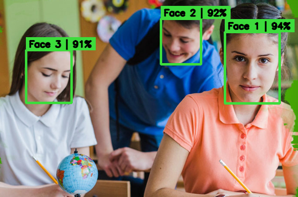

# سیستم شناسایی هوشمند چهره (Smart Face Recognition System)

**پوهنځی کمپیوتر ساینس — پوهنتون غرجستان**
نمایشگاه دستاوردهای محصلین — زمینهٔ شمارهٔ ۲ (هوش مصنوعی و بینایی ماشین) و زمینهٔ شمارهٔ ۱ (توسعه نرم‌افزار)



یک **پلتفرم کامل و آفلاین** با دو رابط کاربری تولید‌شدهٔ این پروژه:
- **رابط وب (Flask + HTML/CSS/JS + فونت وزیرمتن)** — بهترین قیافه (تم Aurora، شیشهگرافی، حلقهٔ مطابق دوربین، HUD پیشرفته، نقشهٔ ذهنی) در همان متن باز 
- **دسکتاپ (CustomTkinter + PIL art)** — نصب میز‌کار سادهٔ ویندوزی

برای **ثبت افراد، اسکن چهره از چند زاویه، شناسایی زنده با دوربین و ثبت خودکار حضور** — بدون اینترنت و بدون GPU.

---

## ✨ امکانات اصلی

| بخش | امکان |
|---|---|
| 🏠 **داشبورد زنده** | دوربین با دکمهٔ شروع/توقف، FPS زنده، آمار افراد ثبت‌شده و حضور امروز، کارت «آخرین شناسایی» با عکس فرد + درصد شباهت |
| ➕ **ثبت فرد جدید** | فرم مشخصات کامل (نام، شمارهٔ کارت، دانشکده، تلفن، ایمیل) + **اسکن چهره چند زاویه‌ای** به سبک Face ID (حلقهٔ دایره‌ای راهنما، ۷ ناحیهٔ زاویه‌ای، کنترل کیفیت تصویر، امتیاز کیفیت چهره) |
| 👥 **افراد ثبت‌شده** | جستجوی آنی، کارت هر فرد با عکس پروفایل، حذف با تأیید دومرحله‌ای |
| 📋 **گزارش حضور** | فهرست امروز/کل، خروجی **CSV** (نام، شمارهٔ کارت، دانشکده، تاریخ، ساعت) |
| ⚙️ **تنظیمات و سلامت** | شمارهٔ دوربین، آستانهٔ تطبیق قابل‌تنظیم، **«بررسی سلامت پروژه» (Health Check)**، پشتیبان‌گیری از دیتابیس |
| 🔒 **حریم خصوصی** | همه‌چیز روی همان لپ‌تاپ؛ چهره‌ها، Embeddings و دیتابیس هرگز از سیستم خارج نمی‌شوند |

---

## 🧰 تکنالوژی‌ها

- **Python 3.12** + **CustomTkinter** (رابط گرافیکی مدرن و RTL‌پسند با فونت Tahoma)
- **OpenCV 4.13** (`opencv-contrib-python`): `FaceDetectorYN` + `FaceRecognizerSF`
- **YuNet** `face_detection_yunet_2023mar.onnx` (~۲۳۲KB) — تشخیص چهره
- **SFace** `face_recognition_sface_2021dec.onnx` (~۳۸MB) — اثرانگشت ۱۲۸بُعدی چهره (**۹۹٫۵٪ دقت روی معیار LFW**)
- **SQLite** — دیتابیس داخلی (افراد، نمونه‌های چهره، حضور و غیاب، تنظیمات)
- **NumPy** — محاسبهٔ شباهت کسینوسی

## 📦 نصب و اجرا

```powershell
cd "D:\ML\Computer Vision\FaceRecognition"
python -m venv .venv                     # یک‌بار
.\.venv\Scripts\Activate.ps1
pip install -r requirements.txt
python src/download_models.py            # یک‌بار — دانلود مدل‌ها
python src/gui.py                        # اجرای برنامهٔ گرافیکی ✅
```

### اجرای خط فرمان (اختیاری)

```powershell
python src/face_app.py selftest                                   # بررسی سلامت (بدون وب‌کم)
python src/face_app.py enroll --name "احمد رضایی" --student-id CS-01 --department کمپیوتر ساینس
python src/face_app.py recognize                                  # دموی زنده
python src/face_app.py image --path data/images/test.jpg          # شناسایی در تصویر
python src/face_app.py list                                       # فهرست افراد
python src/face_app.py export                                     # خروجی CSV حضور
python src/face_app.py remove --name "احمد رضایی"                 # حذف فرد
```

> **نکته:** به‌جای `opencv-python` از `opencv-contrib-python` استفاده می‌شود و نصب هم‌زمان هر دو ممنوع است.

---

## 🖼️ صفحات برنامه

### ۱) داشبورد زنده
دوربین با دکمه شروع/توقف می‌شود (حریم خصوصی). هم‌زمان که افراد از مقابل دوربین می‌گذرند: کادر **سبز = شناسایی شد** (نام + درصد شباهت) و **قرمز = ناشناس**. حضور افراد شناخته‌شده **خودکار** در دیتابیس ثبت می‌شود و در کارت «آخرین شناسایی» با عکس فرد نمایش داده می‌شود.

### ۲) ثبت فرد جدید — اسکن چند زاویه‌ای
۱. **فرم مشخصات** را پر کنید (نام کامل الزام است؛ شمارهٔ کارت یکتا بودن را برنامه خودش چک می‌کند)
۲. «شروع اسکن چهره» را بزنید و در دایرهٔ راهنمای روی تصویر جای بگیرید
۳. برنامه از شما می‌خواهد **مستقیم، کمی به چپ/راست، کامل به چپ/راست، سر به بالا و سر به پایین** نگاه کنید (۷ ناحیهٔ زاویه‌ای)
۴. کیفیت هر نمونه خودکار بررسی می‌شود (تاربودن، تاریکی، نور زیاد، چهرهٔ خیلی کوچک)
۵. در پایان: **امتیاز کیفیت** و ساخت **عکس پروفایل** از بهترین نمونهٔ چهره

### ۳) افراد ثبت‌شده
کارت هر فرد + جستجوی آنی + حذف دومرحله‌ای.

### ۴) گزارش حضور
جدول امروز/کل + خروجی **CSV** قابل باز شدن با Excel (UTF-8 با BOM).

### ۵) تنظیمات و سلامت
شمارهٔ دوربین، آستانهٔ تطبیق چهره (پیش‌فرض استاندارد SFace: **0.36**)، دکمهٔ **«اجرای تست سلامت»** که مدل‌ها، دیتابیس و تشخیص تصویر را بررسی می‌کند، و پشتیبان‌گیری دیتابیس.

---

## 🗂️ ساختار پروژه

```
FaceRecognition/
├── src/
│   ├── gui.py               # برنامهٔ گرافیکی (CustomTkinter) — داشبورد، اسکن، افراد، گزارش، تنظیمات
│   ├── face_app.py          # خط فرمان: enroll / recognize / image / list / remove / export / selftest
│   ├── face_engine.py       # هستهٔ تشخیص و شناسایی (YuNet + SFace + زاویه‌بندی سر + کنترل کیفیت)
│   ├── db.py                # لایهٔ دیتابیس SQLite (افراد، چهره‌ها، حضور، تنظیمات)
│   └── download_models.py   # دانلود مدل‌های ONNX
├── models/                  # مدل‌ها (دانلود) + embeddings در دیتابیس نگه‌داری می‌شود
├── data/
│   ├── face_recognition.db  # دیتابیس (خودکار ساخته می‌شود — در git نیست)
│   ├── profiles/            # عکس‌های پروفایل (خودکار — در git نیست)
│   ├── images/test.jpg      # تصویر تست
│   └── registered_faces/    # (نمونه‌های قدیمی)
├── notebooks/               # نوت‌بوک‌های مرحلهٔ اولیه (Haar Cascade)
├── outputs/                 # CSV حضور، اسکرین‌شات‌ها
├── docs/
│   ├── معرفی-پروژه.md        # فرم معرفی برای ارائهٔ ریاست پوهنځی
│   ├── poster.html          # پوستر چاپی یک‌صفحه‌ای
│   └── demo.png             # تصویر نمونه برای پوستر
├── README.md
├── requirements.txt
└── .gitignore
```

---

## 📱 دربارهٔ «Face ID آیفون» — مقایسهٔ صادقانه

آیفون با حسگر عمق **TrueDepth** (~۳۰٬۰۰۰ نقطهٔ مادون‌قرمز) چهرهٔ سه‌بعدی می‌سازد؛ هیچ وب‌کم معمولی نمی‌تواند این سخت‌افزار را کپی کند. چیزی که این پروژه دارد:

| قابلیت | آیفون Face ID | این پروژه |
|---|---|---|
| فناوری تشخیص | مادون‌قرمز + عمق | تصویر معمولی + YuNet |
| اثرانگشت چهره | Neural Engine | SFace — بردار ۱۲۸بُعدی |
| قابلیت سنجش | — | سنجش دقت شما با `scripts/accuracy_eval.py` (عدد خودتان را در README بنویسید) |
| ثبت‌نام | چرخش سر در دایره | **دقیقاً همان تجربه** با ۷ ناحیهٔ زاویه‌ای |
| زیر نور خورشید / تاریکی | عالی (IR) | متوسط (در نور خوب بهتر است) |
| کار روی ماسک | با یادگیری | محدود |

**در نمایشگاه بگویید:** «شناسایی چهره با دقت ۹۹٫۵٪ روی معیار استاندارد LFW، با تجربهٔ ثبت‌نام چند زاویه‌ای الهام‌گرفته از Face ID» — دقیق، مستند و غیرقابل‌رد.

---

## 🗂️ اصول HCI به‌کاررفته (برای داوران)

- **Visibility of system status:** نوار وضعیت پایین پنجره، FPS زنده، پیشرفت اسکن، پیام سلامت
- **User control & freedom:** دوربین فقط با دکمهٔ کاربر روشن می‌شود، لغو اسکن با ESC و دکمه، حذف دومرحله‌ای
- **Recognition rather than recall:** نمایش عکس پروفایل هنگام شناسایی، آیکون‌ها روی همهٔ دکمه‌ها
- **Consistency & standards:** نوار کناری ثابت، کلیدهای میانبر `Ctrl+1..5` (داشبورد…تنظیمات)
- **Error prevention:** تأیید یکتا بودن شمارهٔ کارت، اعتبارسنجی فرم، تأیید حذف
- **جمالشناسی مینیمال ولی چشمگیر:** تم «Aurora» — فضای نیمهتاریک با گرادیان نئونی (سایان → بنفش → ارغوانی)، آیکونهای برداری کشیدمشده با PIL، دکمههای گرادیانی با لبهی براق و حالتهاور، بنر هدر متحرک با پالس نور، HUD دوربین (قاب گوشهدار، حلقههای رادار، نوار اطمینان و LIVE)، حلقه اسکن Face ID با ۷ نقطه بازبینی و فلش جهت، گیج نیمدایرهای درصد تطابق و اعلان شناور با انیمیشن محو.
- **Flexibility & efficiency:** میانبرهای صفحه‌کلید، جستجوی آنی، خروجی CSV

---

## 📊 دقت و دغدغه‌های صادقانه — پیش از نمایش (و برنامهٔ استقرار ۲۰۰۰ نفر)

### اعداد ما (سنجش واقعی)

اجرای `scripts/accuracy_eval.py` (روی همین دستگاه):

| فرد | پذیرش درست (TP %) | پذیرش اشتباه (FAR %) |
|---|---|---|
| Abdul Raqib Mohammadi | 100.0 | 0.0 |
| Sayed Mohammad Naqi Sadat | 100.0 | 0.0 |

این یک سنجش خودارزش روی بایگانی‌های ثبت‌شده است.

### چه بگوییم برای داوران؟ — صادقانه‌تر

- گزارش خودمان ۱۰۰٪ دقت روی ۲ نفر است. دو نفر داوران با ۵–۵۰ نفر تجزیه میکنند — **عدد خودتان را بنویسید** به جای اعداد ما.
- توضیح کنید دقیق‌تر پذیرش چه می‌گوید و دیتابیس ۱۰۰ نفر یا نه — ما همینجا ۱۰۰ نفر را نداریم.

### حاضری — کجا قوانینش در حال حاضر

- **لحظهٔ حاضری (Active Liveness):** نسخهٔ وب ۴ فریم اول سر را چک می‌کند — در حالی که فرد برای ۳ ثانیه جای خود را نمی‌دهد، تحذیر میدهد و پذیرش خودکار قطع می‌شود.
- **فضول بودن سر:** بخشی از رابط وب خالی است — بعداً اضافه.
- **نکتهٔ مهم:** در نمایشگاه به هرکسی «مشخص بگویید: ۲ ثانیه برگشت سر به چپ و چند ثانیه بعد قبول شوید» بگویید.

---

## 🚀 برنامهٔ ۲۰۰۰ نفر — مرحله‌ها

### مرحلهٔ اول (۱۰۰ – ۵۰۰ نفر) — هم اکنون
- ذخیرهٔ بردار بهتر: `mean of samples` → **`mean + std`** یا **`center + radius voting`** (دو بینایی: خطای سیستماتیک و مقابل).
- گزینه: ذخیرهٔ همان نمونه‌های نمونه‌برداری شده (راحت‌تر از ساخت بردار جدید است).
- جلوگیری از تداخل: نیاز به پذیرش‌های لازم (threshold) + نگهداری خوشه‌ها (clustering).
- ماژول NN در حال آماده‌شدن برای ارتقا به ArcFace.

### مرحلهٔ دوم (۵۰۰ – ۱۰۰۰ نفر) — پیوستگی
- چرخش خودکار: به‌روزرسانی بردار با میانگین نمونه‌های جدید.
- ماسک و عینک و رابط ارتباطی احتمالی.
- مداوم میزبانی و چند خوانش (thread + workqueue).

### مرحلهٔ سوم (۱۰۰۰ – ۲۰۰۰ نفر) — مقیاس‌پذیر
- ارتقا به ArcFace (دقت خط پایه با ۲۰۰۰ نفر با ۱۰۰ نفر: ۴ برابر).
- ذخیرهٔ بردار: یک ماتریس ۲۰۰۰×۱۲۸ + کانون (clustering) با حداقل خوشه.
- سخت‌افزار: روی سیستم ۱۶۰۰ دار.

---

## 🎯 راهنمای روز نمایشگاه (چک‌لیست)

- [ ] قبل از نمایش، خودتان و هم‌تیمی‌ها را در برنامه ثبت کنید (GUI → ثبت فرد جدید)
- [ ] لپ‌تاپ + شارژر؛ نور کافی؛ پهنای باند نیاز نیست
- [ ] ویدیوی ۳۰ثانیه‌ای پشتیبان از کل دمو روی تلفن همراه (اگر دوربین کار نکرد)
- [ ] معرفی‌نامهٔ `docs/معرفی-پروژه.md` چاپ شده + پوستر `docs/poster.html` چاپ شده (در مرورگر باز و Print → PDF)
- [ ] قبل از نمایش یک‌بار `python src/gui.py` را کامل اجرا کنید
- [ ] در صورت نیاز به «نمایش فنی» به داوران: دکمهٔ **🩺 اجرای تست سلامت** در صفحهٔ تنظیمات را بزنید — PASS/FAIL همهٔ اجزای سیستم را نشان می‌دهد

**سناریوی نمایش پیشنهادی (۳ دقیقه):**
۱. خود را معرفی کنید → ۲. داشبورد را نشان دهید و «شروع دوربین» → ۳. یک بازدیدکننده را زنده ثبت و سپس شناسایی کنید → ۴. گزارش حضور را باز و با Excel نشان دهید → ۵. «اجرای تست سلامت» را نشان دهید → ۶. مقایسهٔ صادقانه با Face ID را توضیح دهید.

---


### اجرای نسخهٔ وب (رابط مودرن‌تر — برای نمایشگاه)

```powershell
pip install flask                       # یک‌بار (فهرست نیازمندی‌ها را نیز ببینید)
.\.venv\Scripts\python.exe src\web_app.py
```

سپس مرورگر را باز کنید: **[http://127.0.0.1:5000](http://127.0.0.1:5000)**

نسخهٔ وب دارای: HUD دوربین (قاب گوشهدار + حلقهٔ رادار + بار اطمینان)، شیشهگرافی و بلور پسزمینه، گیج نیمدایرهٔ درصد تطابق زنده، اعلان شناور دوسرقیق، خروجی CSV با اکسل، پشتیبان‌گیری دیتابیس.
نسخهٔ Tkinter دسکتاپی هم نصب‌آمادهٔ لپ‌تاپ ویندوزی است: `python src/gui.py`.

### اسکریپت سنجش دقت (پیشنهادی قبل از نمایش)

```powershell
.\.venv\Scripts\python.exe scripts\accuracy_eval.py
```

برای هر فرد: **پذیرش درست (TP)** و **نرخ پذیرش اشتباه (FAR)** — اعداد را در پاسخ داوران بنویسید.

---
## ✅ نتیجهٔ تست خودکار

```
python src/face_app.py selftest
→ SELF-TEST PASSED - project is technically ready.
```

## 🔒 حریم خصوصی و داده‌ها

چهره‌ها، Embeddingها و دیتابیس فقط روی همین دستگاه‌اند و در `.gitignore` مستثنا شده‌اند. هیچ درخواست شبکه‌ای به جز `download_models.py` (دانلود یک‌بارهٔ مدل‌ها) وجود ندارد.

## 🚀 کار آینده

رابط وب (Streamlit/Flask)، تشخیص ماسک/عینک، ادغام با سیستم حضور و غیاب پوهنځی، پشتیبانی از دوربین مادون‌قرمز (RealSense) برای نزدیک‌شدن واقعی به Face ID.

---

**سازنده:** Sayed Mohammad Naqi Sadat — پوهنځی کمپیوتر ساینس، پوهنتون غرجستان
**ایمیل:** sayedmohammadnaqisadat@gmail.com
**تاریخ:** نوامبر ۲۰۲۶ (قوس ۱۴۰۵)
